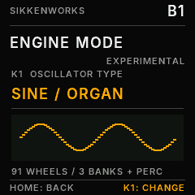

# B1

**A drawbar organ for the M-VAVE FM-1.**

Classic tonewheels, nine drawbars, rotary speaker, percussion and an experimental sawtooth engine, built into a pocket-sized instrument.

[The instrument](#the-instrument) &nbsp;·&nbsp; [How to use it](#how-to-use-it) &nbsp;·&nbsp; [Effects](#effects) &nbsp;·&nbsp; [Projects](#projects) &nbsp;·&nbsp; [Installation](#installation) &nbsp;·&nbsp; [Credits](#credits) &nbsp;·&nbsp; [Changelog](CHANGELOG.md)

---

## The instrument

B1 is open-source organ firmware by **SikkenWorks** for the **M-VAVE FM-1**. Rather than playing back an organ recording, it builds the sound from tonewheel-style harmonics that you mix with drawbars while you play.

B1 has two sound engines: the original **SINE / ORGAN** tonewheels and an experimental **SAWTOOTH** mode. In either engine, choose **B3 / LESLIE** for the classic organ sound or **ROCK / LORD** for a more aggressive amplifier character. Shape the result with percussion, key click, leakage, scanner chorus/vibrato, rotary speaker, delay and reverb.

| | |
| :-- | :-- |
| **Sound engines** | SINE / ORGAN and experimental band-limited SAWTOOTH |
| **Tonewheels** | 91 shared, continuously running oscillators |
| **Drawbars** | Nine harmonic drawbars per registration |
| **Organ characters** | B3 / LESLIE and ROCK / LORD |
| **Polyphony** | Up to 12 simultaneous voices |
| **Registrations** | UPPER, LOWER and SOLO |
| **Performance** | Four keyboard ranges, chords, CHORD ATTACK, 48 scales and MIDI routing |
| **Effects** | Scanner chorus/vibrato, rotary speaker, delay and reverb |
| **Memory** | 12 named, persistent projects |

## How to use it

### 01 / Shape the organ with drawbars

Each drawbar controls a different harmonic. Pull it out to make that part of the sound louder; push it in to remove it. The nine drawbars follow the familiar tonewheel-organ order:

| Drawbar | Harmonic character |
| :-- | :-- |
| `16′` | Deep, one octave below the fundamental |
| `5⅓′` | Fifth above the 8′ fundamental |
| `8′` | Fundamental note |
| `4′` | One octave above |
| `2⅔′` | One octave and a fifth above |
| `2′` | Two octaves above |
| `1⅗′` | Two octaves and a major third above |
| `1⅓′` | Two octaves and a fifth above |
| `1′` | Three octaves above |

The drawbars use the usual **0–8** registration scale: `0` is silent and `8` is fully open. They respond smoothly to changes, including when notes are held.

B1 has three separate registrations: **UPPER**, **LOWER** and **SOLO**. Each has its own nine-drawbar setting. Use the organ and range pages to assign the sounds across the keyboard.

### 02 / Switch between ORGAN and SAWTOOTH

Hold **HOME + FX together** to open **ENGINE MODE**. The two buttons have a short recognition window, so you do not need to press them at precisely the same instant.

| Control | Action |
| :-- | :-- |
| **HOME + FX** | Open the ENGINE MODE screen |
| **K1 left** | Select **SINE / ORGAN** |
| **K1 right** | Select **SAWTOOTH** |
| **SEL** | Toggle between the two modes |
| **HOME** | Return to the normal drawbar screen |

**SINE / ORGAN** is B1's original organ engine. **SAWTOOTH** changes all 91 tonewheels to frequency-appropriate, band-limited saw waves: the same drawbars, registrations, keyboard assignments and effects still apply. A short crossfade makes it possible to switch while holding notes, without abruptly restarting the tonewheels.

 &nbsp; 

The selected mode belongs to the current project. A new project starts in **SINE / ORGAN**, and older projects without an engine-mode setting also open in ORGAN.

### 03 / Choose the character

**B3 / LESLIE** is the cleaner, classic organ path. Shape the sound with percussion, key click and tonewheel leakage, then add scanner chorus/vibrato and rotary-speaker movement.

**ROCK / LORD** sends the drawbar organ through a driven, asymmetric amplifier and a frequency-shaped guitar cabinet. Turn up **AMP GAIN / DRIVE**, then adjust **TONE** and **CABINET** for the speaker character. B3 / LESLIE remains available without changing projects.

Other organ controls include:

- **Percussion:** the second or third harmonic uses one shared, non-retriggering envelope for all held keys on UPPER. The third harmonic is enabled by default in new or reset projects.
- **Key click and leakage:** adjust the mechanical character of the instrument.
- **Scanner chorus/vibrato:** C/V modulation for classic organ movement.
- **Rotary speaker:** **FAST** and **ROTOR MIX 60** by default in a new or reset project, with adjustable SLOW / FAST speeds, drum-speed relationship and blend.

For a loud, classic rock-organ starting point: choose **SINE / ORGAN**, UPPER drawbars **888800000**, **ROCK / LORD**, moderately high **DRIVE** and **AMP GAIN**, and adjust **CABINET** and **TONE** to taste. Use **ROTOR MIX 0** for a stationary amplifier sound, or blend in rotary movement. Key click adds attack at lower values, while leakage gives subtle generator character. These are suggested settings, not fixed presets; the parameters remain fully editable and savable.

### 04 / Play, split and harmonize

Use the FM-1 keys or MIDI input to play B1. Its performance controls include:

- **Four keyboard ranges** for routing UPPER, LOWER, SOLO and chord selection.
- **CHORD ASSIGN ON/OFF:** on the CHORD ASSIGN page, use **K3** to enable or disable chord selector keys. With a new project, CHORD ASSIGN starts **OFF**. Turning it ON can create a selector zone at keys **21–27** when a suitable range slot is free.
- **Assign chords:** use **K2** to choose a chord quality and press a physical key in the active CHORD range to assign it; **K1** browses the physical key numbers.
- **Chord-key LEDs (V4.0):** with CHORD ASSIGN ON, every active chord selector stays steadily lit on the physical keyboard, even without holding it. Dark keys remain normal organ keys; pressing a key still lights it temporarily. This follows the actual active ranges, including overlaps, saved projects and range edits. On the **SCALE** page, the existing GUIDE takes priority so the 48-scale indication remains available. CHORD ASSIGN OFF shows normal LEDs.
- **CHORD ATTACK:** turn **K4** on the CHORD ASSIGN page (or on the active CHORD-range page) to set humanized onset timing from **0** (simultaneous) to **100** (up to roughly 65 ms, with a varied note order). To audition it, hold a chord selector key and play an ORGAN-range key.
- **48 scales**, with root-note, **KEYLOCK** and **GUIDE** options.
- **Global octave** and MIDI/range routing.

Switching CHORD ASSIGN OFF returns the keys to normal organ playing; it does **not** erase the saved chord assignments. Performance settings are part of the project, not a separate temporary preset.

### 05 / Navigate and edit

B1 uses the FM-1's screen, rotary controls and buttons. Open a parameter page, then use its labelled knobs to change the values shown on screen.

For the effects pages, **K1–K4** correspond to the parameters listed below. In the project loader, turn **K1** or **SELECT** to choose a slot and press the physical **SEL** button (second button from the left in the upper row) to load it.

## Effects

B1 combines the organ's built-in modulation with separate delay and reverb pages.

### Rotary speaker and scanner

The rotary effect provides SLOW / FAST motion, adjustable rotor speeds, drum-speed balance and a ROTOR MIX setting (60 in new projects). Scanner chorus/vibrato adds a separate modulation character. Both can be used to give sustained notes movement.

### FX 5/6 · Delay

| Control | Parameter | Range |
| :-- | :-- | :-- |
| K1 | MIX | 0–100 |
| K2 | TIME | 0–100 (approximately 32–350 ms) |
| K3 | FEEDBACK | 0–90 |
| K4 | STEREO | 0–100 |

### FX 6/6 · Reverb

| Control | Parameter | Choices / range |
| :-- | :-- | :-- |
| K1 | TYPE | OFF, SPRING, ROOM, HALL, CATHEDRAL |
| K2 | MIX | 0–100 |
| K3 | DECAY | 0–100 |
| K4 | DAMP | 0–100 |

Delay and reverb can continue to ring out briefly after you release the keys. With the effects off, a dry registration returns to silence.

## Projects

B1 stores **12 named projects** in persistent memory. A project holds the complete organ setup, including:

- All nine drawbars for UPPER, LOWER and SOLO.
- Keyboard ranges, chord assignments and chord attack.
- Scale, root, KEYLOCK, GUIDE and global octave.
- Percussion, key click, leakage, amplifier and organ bank.
- Rotary and scanner settings, delay and reverb.
- **ENGINE MODE:** SINE / ORGAN or SAWTOOTH.

To **load** a project, open the project loader, choose a slot with **K1** or **SELECT**, then press **SEL**. A successful operation shows `PROJECT LOADED` on screen. Saving uses the project's save function and confirms with `PROJECT SAVED`.

Existing saved projects keep their stored settings. New or reset projects start in ORGAN, with **percussion ON (3rd harmonic)**, **rotor FAST** and **ROTOR MIX 60**. Legacy project files without an engine-mode flag select ORGAN automatically.

## Installation

The firmware is intended for the **M-VAVE FM-1**. **A valid offline-built `.fwsc` is included, but hardware boot, sound and OTA updating still require an actual FM1 test.** The repository contains a freshly compiled update package and a browser-based installer. Rebuild both together with `JIELI_TOOLCHAIN=/path/to/jieli-linux-toolchains-20250324.1 python3 tools/build_v38_release.py`.

| File / directory | Purpose |
| :-- | :-- |
| `B1-WebInstaller.html` | WebMIDI-based installer for a supported browser and compatible device |
| `build/SikkenWorks-B1-V4.4-BEETLE-OTA.fwsc` | B1 V4.4 firmware update candidate (`FM-1_2146`), built with the pi32v2 compiler |
| `build/BEETLE-RC1.01-RESTORE-ORIGINAL.fwsc` | Original BEETLE reference package, included for recovery planning |
| `build/B1.elf` and `build/B1-app.bin` | Actual native pi32v2 linked ELF and flattened application image
| `firmware/` | Full C firmware source and platform integration |
| `tools/` and `tests/` | Build and verification utilities |
| `ui-captures/` | Native 240 × 240 UI captures, including ORGAN and SAWTOOTH mode screens |
| `audio-reference/` | Software-rendered audio examples |

Use **Chrome or Edge with WebMIDI** and follow the WebInstaller's device and firmware checks. The installer can validate compatible FM-1 `.fwsc` files that match B1's protected BEETLE boot-header and loader requirements. For a different firmware layout, **ENTER UBOOT** requests a handoff to the FM-1's independent update environment; the target firmware must then be installed with its own compatible installer. Neither path is a universal flasher.

**Before installing:** back up your projects and keep an independent, tested recovery method. Firmware V4.4 has passed native compilation, offline packaging and software tests, **not** a successful flash, boot or rollback on a physical FM-1. The earlier on-device `OTA FAILED -16` report has not been proven resolved by physical testing. Do not keep retrying a failed update, bypass the loader checks, or assume the included BEETLE reference is a universal recovery image.

## Credits

**B1** is developed by **SikkenWorks**.

B1 incorporates platform work from **Felucca**, developed by **Leo Kuroshita / Hügelton Instruments** and contributors. The applicable hardware abstraction, USB/OTA integration and associated files retain their original copyright notices.

B1 is released under **GPL-3.0-only**. The included Inter font is subject to its own **SIL Open Font License 1.1** (`firmware/third_party/INTER-OFL-1.1.txt`). See [`CREDITS.md`](CREDITS.md) and the accompanying license texts for the complete attribution and terms.

---

**SikkenWorks** · Born out of passion.

[Version history](CHANGELOG.md)

**Firmware package identity policy:** The native application, USB-MIDI identification and `.fwsc` product marker remain `FM-1_2147` for V4.6 and future revisions unless the owner explicitly changes this requirement. Do not derive product IDs from release labels.
