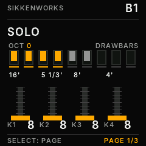

  

# SikkenWorks B1 V2.4 — Rotor Defaults

Custom M-VAVE FM1 rock-organ firmware. Full GPL-3.0-only source included.

## V2.4: Factory defaults (only new/reset projects)

- Factory rotor is **FAST**.
- Factory ROTOR MIX is **60** (previously 90).
- Rotor initial phase increments agree with FAST so there is no hidden SLOW-to-FAST warm-up on a new/reset project.
- Existing saved projects keep their saved rotor mode and mix when loaded; no automatic project migration or rewriting.
- The organ, effects, project format, boot animation and other code paths are retained.
- 62 pixel-exact 240 × 240 native firmware screens can be downloaded as one separate ZIP containing individually named PNGs.

## Changes inherited from V2.3

- **Chorus/vibrato:** a fractional-delay 8-bit interpolated scanner replaces stepping between integer tap locations in both the full and SAFE-DSP paths. A smoothed dry/wet ramp prevents abrupt mode changes. This removes the known zipper-noise source at the DSP-code level; the physical FM1 still needs a listening test.
- **FX 5/6 — DELAY:** K1 MIX (0–100), K2 TIME (0–100; ~32–350 ms), K3 FEEDBACK (0–90), K4 STEREO (0–100).
- **FX 6/6 — REVERB:** K1 TYPE (OFF, SPRING, ROOM, HALL, CATHEDRAL), K2 MIX (0–100), K3 DECAY (0–100), K4 DAMP (0–100). These are original low-memory integer DSP algorithms, not a sampled impulse-response library.
- **Effect tails:** intentional delay/reverb tails fade for a bounded duration after the last key release. No unkeyed tonewheel signal is mixed into them. Earlier complete-silence behavior remains for dry presets.
- **Project loading:** choose one of 12 slots with K1 or turning SELECT, then press the physical **SEL** button (upper button row, second from left). ALGORITHM is not needed.
- **Visible saved/loaded feedback:** `PROJECT SAVED` or `PROJECT LOADED` appears for 1.6 s. Errors remain separately shown.
- **All musical parameters saved:** drawbars for UPPER/LOWER/SOLO; all four ranges including chord ATTACK; chord assignments; scale/root/KEYLOCK/GUIDE; percussion, click, leakage, Leslie settings, B3/ROCK amp, chorus/vibrato, rotor speeds; delay and reverb; global octave and selected organ bank.
- **Old project compatibility:** flash journal schema 1 / project V5 (from B1 V2.2) is read and migrated to schema 2 / project V6; the next successful save writes the new schema as a copy-on-write journal. The old sector is not overwritten before the new committed archive is verified.
- **Startup and recovery:** SikkenWorks particle startup, safe mode, BEETLE-compatible OTA header and updater are retained. BEETLE backup included.

## Firmware package

- `build/SikkenWorks-B1-V2.4-BEETLE-OTA.fwsc` — real JieLi application update candidate; not yet physically verified.
- `B1-WebInstaller.html` — standalone web installer embedding the exact same `.fwsc`. Requires a supported browser/WebMIDI and device compatibility.
- `build/BEETLE-RC1.01-RESTORE-ORIGINAL.fwsc` — unmodified original BEETLE reference.
- `firmware/` — complete C firmware sources, JieLi build and Felucca HAL.
- `tools/`, `tests/` — build, verification, audio and pixel-exact UI test tooling.
- `ui-captures/` — 62 RGB565 firmware snapshots and matching PNGs, GIF and manifest.
- `audio-reference/` — 7 three-second WAV renders made by the exact native C DSP.

## Installation caution

The resulting `.fwsc` is packaged and offline verified against a BEETLE RC1.01 header reference. This **does not prove** flashing, booting, audio timing, saved-project migration, or rollback on the physical FM1. Keep a proven independent recovery method. Back up projects before any experiment. Never erase unknown flash regions merely to solve a storage error. These limits matter especially when the installed firmware or hardware revision differs from the supplied BEETLE reference.

## Copyright and credits

SikkenWorks B1 — GPL-3.0-only. Felucca's platform hardware abstraction, USB/OTA layer and other relevant files remain copyright © Leo Kuroshita / Hügelton Instruments and their contributors under GPL-3.0-only. See `CREDITS.md` and the supplied license texts. `INTER-OFL-1.1.txt` also remains included as applicable to the font.
